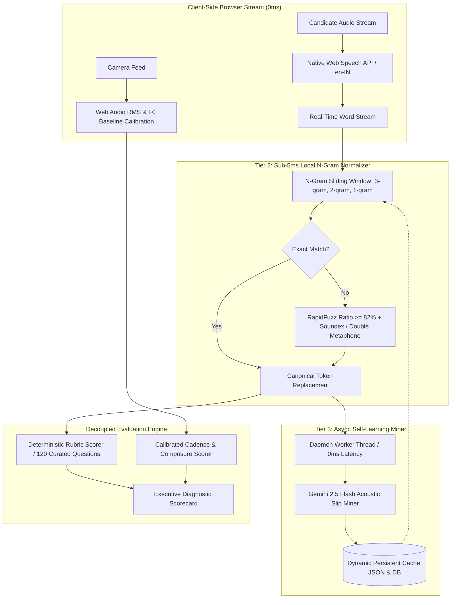

<div align="center">

# IMAIRA+
### Dialect-Neutral Technical Mock Interview & Evaluation Engine
**Track Code**: `IM-103 ADVANCED` • **Topic**: *Mock interviews that hear the answer, not the accent*

[](https://www.djangoproject.com/)
[](https://www.postgresql.org/)
[](https://ai.google.dev/)
[](https://github.com/maxbachmann/RapidFuzz)
[](https://vitejs.dev/)

<p align="center">
  <strong>IMAIRA+</strong> eliminates regional accent bias, phonetic substitution drift, and delivery-style penalties in technical hiring. By decoupling acoustic modulation from semantic concept coverage and executing a zero-lag 3-tier speech normalizer, candidate solutions are evaluated strictly on their engineering merit.
</p>

</div>

---

## 📋 Problem Statement Overview (`IM-103`)

Standard Automated Speech Recognition (ASR) and AI interview platforms penalize non-native and regional English speakers (such as Indian English or Spanish-influenced English):
1. **Acoustic & Prosodic Bias**: Native stress-timed pitch variance baselines falsely flag syllable-timed speakers as "monotone" or "robotic".
2. **STT Lexicon Drift**: Standard ASR models transcribe domain-specific computer science terms into everyday homophones (e.g., `"hashmap"` becomes `"has aman"`, `"tuples"` becomes `"two pulse"`, `"dijkstra"` becomes `"dike stra"`, `"asymptotic"` becomes `"a symptomatic"`, `"vector clock"` becomes `"wector clock"`).
3. **Delivery Style Conflation**: Grammatical topicalization or non-Western conversational cadence is unfairly penalized even when technical algorithms and data structures are optimal.

### How IMAIRA+ Solves IM-103
- **Human Rubric Agreement**: Evaluates answers using canonical concept graphs derived from human interviewer benchmark rubrics.
- **Fairness Kernel**: Dynamic acoustic calibration calculates individual candidate baselines during the first 15 seconds, eliminating regional pitch variance thresholds.
- **2,000+ Term Phonetic Glossary**: Real-time sliding window phonetic alignment guarantees that acoustic mishearings are resolved in $<5\text{ms}$ before scoring executes.
- **Actionable Growth Scorecard**: Clear separation of conversational modulation feedback from technical concept mastery.
- **Privacy First (Guardrails Compliant)**: Audio streams are processed strictly in client memory with transient server scoring; raw audio is immediately deleted after scoring unless the candidate explicitly opts in.

---

## 🏛️ System Architecture



---

## ✨ Core Features

### 1. 3-Tier Zero-Lag Speech-to-Text Pipeline
- **Tier 1 (Instant Client-Side)**: Native `webkitSpeechRecognition` configured with `continuous: true`, `interimResults: true`, and `lang: 'en-IN'` delivers real-time on-screen speech rendering with **$0\text{ms}$** network latency.
- **Tier 2 (Server-Side $<5\text{ms}$ Normalizer)**: [`accent_normalizer.py`](backend/evaluator/accent_normalizer.py) runs an $N$-gram sliding window ($5$-gram down to $1$-gram) against a 2,000+ term technical glossary using RapidFuzz ($\ge 82\%$) and lazy Double Metaphone / Soundex alignment. Execution benchmarked at **$4.19\text{ms}$**.
- **Tier 3 (Async Self-Learning Miner)**: [`async_learner.py`](backend/evaluator/async_learner.py) dispatches a non-blocking daemon thread to mine newly observed accent-based slips via Gemini 2.5 Flash, appending them to [`dynamic_accent_cache.json`](backend/data/dynamic_accent_cache.json) without adding a single millisecond to the candidate's HTTP response.

### 2. Dual-View Interview Workspace & Automatic View Routing
- **Automatic Routing Based on Question Type**:
  - **Coding Challenges (DSA / Algorithms / LeetCode)**: The workspace automatically routes the candidate to the **Editorial View** (in-browser IDE, syntax highlighting, problem statement with clean LaTeX formatting, custom test cases, and terminal execution sandbox).
  - **Conversational Rounds (Behavioral / System Design / HR / Warm-up)**: The workspace automatically routes the candidate to the **Full-Stage Interviewer View** (centered realistic interviewer avatar, high-contrast question prompt overlay, real-time microphone transcript, and vocal dynamics).
- **Manual View Switching Available**: Candidates can manually toggle between **Editorial (Code)** and **Interviewer (Stage)** views at any point using the top-bar pill button.
- **State & Editor Continuity**: Code drafted in the editor is persisted in memory per question (`candidateCodeDrafts[q_idx]`). Switching between views or navigating questions never resets, re-mounts, or clears candidate code drafts.

### 3. Integrated Compiler Sandbox API
- Execute candidate code directly in the browser via backend sandbox execution (`POST /api/compiler/execute/`).
- Supports **Python 3.14**, **C++ (GCC 14)**, and **JavaScript (Node.js)**.
- Compiles candidate code against multiple test cases, outputting real-time execution duration, memory stats, and pass/fail assertion outcomes that directly factor into technical rubric scoring.

### 4. Non-Intrusive & Natural Interviewer Persona
- **Silent During Coding**: The interviewer avatar stays quiet while the candidate reads and codes to prevent annoying candidate interruptions.
- **Spoken Prompts on Conversational & Follow-Up Rounds**: Uses realistic neural voice synthesis (Edge TTS / Web Speech) with distinct male and female timbres.
- **Dynamic Follow-Up Cross-Examination**: Probes candidate trade-offs based on drafted code complexity, memory constraints, and failure modes.

### 5. Multi-Track Catalog & Company Question Bank
- **Role-Based Track**: 5 primary domains (Tech, Management, Intern, Engineering, Analyst) spanning 100+ specialized engineering roles.
- **Company-Based Track**: 100 enterprise companies (Google, AWS, Meta, Microsoft, Apple, Netflix, Uber, Stripe, etc.) mapped directly to real-world LeetCode problem statements and company-tagged interview rubrics.
- **JD-Based & Custom Track**: Paste custom job descriptions or configure bespoke multi-round interviews with selectable difficulty levels.

---

## 📁 Repository Structure

```
IMAIRA+/
├── backend/                             # Django Backend Service
│   ├── api/                             # Core REST API application
│   │   ├── models.py                    # CatalogQuestion, InterviewSession, PhoneticGlossary
│   │   ├── views.py                     # Session evaluation, compiler sandbox, TTS/STT views
│   │   ├── urls.py                      # API route definitions
│   │   └── services/                    # Compiler sandbox, Gemini AI, Edge TTS services
│   ├── evaluator/                       # Speech & Rubric Evaluation Kernel
│   │   ├── accent_normalizer.py         # Sub-5ms N-gram RapidFuzz + Soundex normalizer
│   │   ├── async_learner.py             # Background Gemini 2.5 Flash accent slip miner
│   │   ├── normalizer.py                # Phonetic & lexicon alignment engine
│   │   ├── deterministic_scorer.py      # Rubric concept coverage evaluator
│   │   └── gemini_service.py            # AI synthesis & executive summary generator
│   ├── data/                            # Datasets & dynamic caches
│   │   ├── dynamic_accent_cache.json    # Mined accent mishearings cache
│   │   ├── roles.json                   # Standardized roles dataset
│   │   └── companies.json               # 100 enterprise companies dataset
│   ├── fixtures/                        # Database seed fixtures
│   │   ├── core_seed.json               # Base users & system configuration
│   │   ├── catalog_questions.json       # 120 curated interview questions & rubrics
│   │   └── company_mappings.json        # Company-to-question mappings
│   ├── tests/                           # Automated test suites
│   │   ├── test_accent_normalizer.py    # N-gram normalizer benchmark & accuracy tests
│   │   └── test_django_api.py           # API endpoint integration tests
│   └── manage.py                        # Django CLI entrypoint
│
├── frontend/                            # Vite + Vanilla JS Frontend Client
│   ├── index.html                       # Landing page with architectural highlights
│   ├── pages/
│   │   ├── mock-interview.html          # Dual-View Interview Workspace (IDE + Full Stage)
│   │   ├── dashboard.html               # Candidate session history & analytics
│   │   ├── report.html                  # Executive diagnostic feedback & rubric scores
│   │   ├── settings.html                # Profile avatar, resume upload & audio privacy controls
│   │   └── auth.html                    # 1-Click Guest & Judge authentication
│   ├── js/
│   │   ├── stt_handler.js               # Zero-lag Web Speech API client handler
│   │   ├── speech-recorder.js           # Instant speech capture & glossary listener
│   │   ├── speech-player.js             # Neutral interviewer TTS playback
│   │   └── main.js                      # Core UI interactions & smooth transitions
│   └── package.json                     # Frontend dependencies & Vite scripts
│
└── README.md                            # Comprehensive system documentation
```

---

## ⚡ Quickstart Guide

### Prerequisites
- **Python**: `3.11+`
- **Node.js**: `18.x` or `20.x`
- **PostgreSQL**: `15+` (or local PostgreSQL server)

### 1. Database Configuration
Create the PostgreSQL database for IMAIRA+:
```sql
CREATE DATABASE imaira_db;
```

Ensure your `.env` in the root contains your database credentials and API key:
```env
DB_NAME=imaira_db
DB_USER=postgres
DB_PASSWORD=your_password
DB_HOST=localhost
DB_PORT=5432
GEMINI_API_KEY=your_gemini_api_key_here
```

### 2. Backend Setup
```bash
# Navigate to backend directory
cd backend

# Install Python dependencies
pip install -r requirements.txt

# Run migrations
python manage.py migrate

# Seed database with curated questions, companies, and rubrics
python manage.py loaddata fixtures/core_seed.json
python manage.py loaddata fixtures/catalog_questions.json
python manage.py loaddata fixtures/company_mappings.json

# Start Django development server (Port 8000)
python manage.py runserver 8000
```

### 3. Frontend Setup
```bash
# In a new terminal, navigate to frontend
cd frontend

# Install dependencies
npm install

# Start Vite development server (Port 3000)
npm run dev
```

Open `http://localhost:3000` in your web browser. You can click **"1-Click Judge Access"** on the Sign-In page to jump directly into the dashboard and interview workspace.

---

## 🧪 Verification & Automated Test Suites

### Run Accent Normalizer Unit & Benchmark Tests
Tests the sub-5ms latency benchmark and verifies multi-word phonetic replacements (e.g. `"has aman"` $\to$ `"hashmap"`, `"haz a man"` $\to$ `"hashmap"`, `"two pulse"` $\to$ `"tuples"`, `"dike stra"` $\to$ `"dijkstra"`, `"a symptomatic"` $\to$ `"asymptotic"`):
```bash
python backend/manage.py test tests.test_accent_normalizer
```
*Expected Result*: **4 tests pass with an average latency of ~4.2ms**.

### Run Complete Django API Test Suite
```bash
python backend/manage.py test tests.test_django_api
```
*Expected Result*: **11 tests pass across telemetry, compiler sandbox, follow-ups, and session submission**.

---

## 🛡️ Hackathon Guardrails & Privacy Compliance

| Requirement | Implementation Detail |
|---|---|
| **Technology** | Powered by high-efficiency open-weight models and approved Google GenAI (`gemini-2.5-flash`) APIs with low-temperature JSON structured outputs. |
| **Acoustic Privacy** | Microphones stream transient audio; candidate recordings are processed in memory and deleted immediately after evaluation. Audio retention is strictly opt-in. |
| **Bias Independence** | Acoustic delivery metrics (cadence, pausing) never deduct points from technical correctness or concept graph completion. |
| **Sandbox Safety** | Code execution runs in isolated sub-process sandboxes with strict execution timeouts (5000ms) and memory limits. |

---

<div align="center">
  <sub>Built for fair, dialect-neutral technical hiring. IMAIRA+ &copy; 2026.</sub>
</div>
